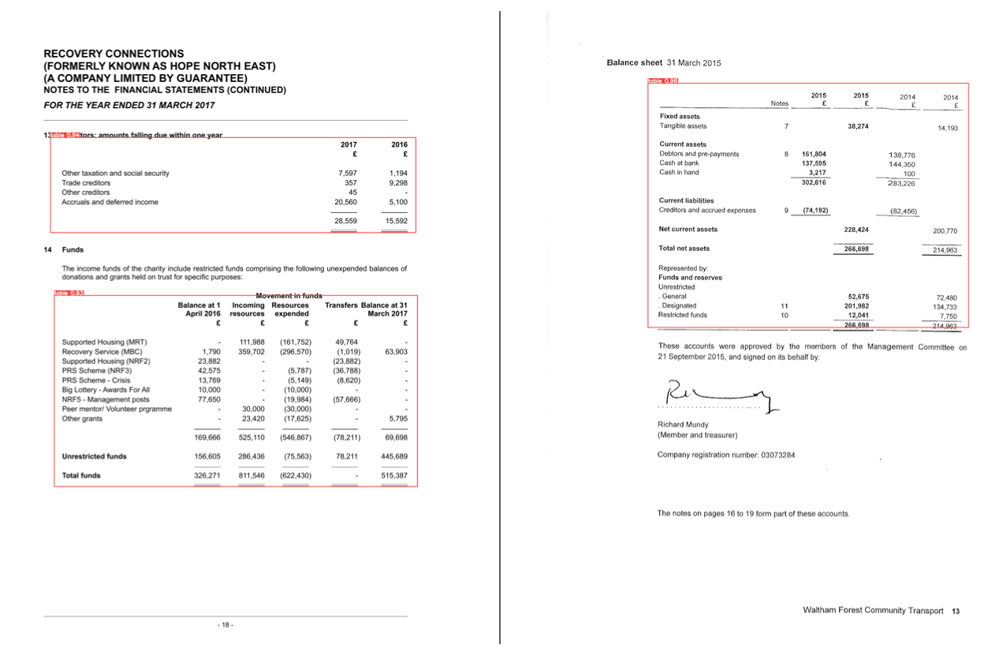

# Key Information Retrieval & Borderless Table Location in Scanned Legal Documents

 **Award-Winning Master's Thesis** This repository contains the source code and documentation for my Master's Thesis, conducted at the **Athens University of Economics and Business (AUEB)** in collaboration with the LegalTech company **Cognitiv+**.

>  **Award:** This thesis was awarded as the **Best Master's Thesis** of the academic year.

The project is unified under a single research goal but is divided into two main core sections:

---

## Project Structure & Components

### 1. Intelligent Borderless Table Detection in Scanned Legal Documents
Financial statements and legal documents often contain critical data embedded in tables that **lack visible borders or gridlines**. Traditional OCR tools and layout parsers frequently fail here, mixing up text columns. 

This component treats table detection as an **Object Detection** problem to accurately locate and extract data from these "blind spots."

* **How it works:** We trained and evaluated state-of-the-art computer vision models—specifically **YOLOv8** and **DETR**—to pinpoint the exact boundaries of hidden, borderless tables. 
* **Extraction:** The **Img2Table** library is then utilized to map out rows and columns, seamlessly converting unstructured image data into clean Excel files.

### 2. Intelligent Invoice Understanding Using Multimodal Language Models
Extracting high-value data points (like issue dates, vendor names, line items, or total amounts) from scanned invoices is a classic but challenging problem in Document Intelligence due to layout variations.

This component explores the capabilities of modern **Multimodal Language Models (Vision-Language Models)** to "read" and understand the context of an invoice.

* **How it works:** Instead of relying on rigid templates, this system uses cutting-edge AI for **Visual Question Answering (Visual QA)**. 
* **Models Used:** We evaluated and fine-tuned **LayoutLM** (which processes text tokens alongside their spatial coordinates/bounding boxes) as well as state-of-the-art Large Language Models like **GPT-4 Vision** and **IDEFICS** to extract information using natural language prompts.

---

## Key Benefits & Impact
* **Award-Winning Project:** Recognized for its performance and real-world impact.
* **Massive Time Savings:** Automates the tedious task of manually reviewing hundreds of legal and financial pages.
* **Layout Awareness:** Combines **Natural Language Processing (NLP)** with **Computer Vision** so the AI understands not just the words, but *where* they are placed on a page.
* **Robustness:** Successfully handles the notoriously difficult problem of borderless tables where standard OCR software usually fails.

---

## Credits
* **Author:** Panagiotis Antoniozas
* **Supervisor:** Ion Androutsopoulos (AUEB NLP Group)
* **Industry Partner:** Cognitiv+

---

## Results

Numbers from the thesis (Chapter 4). Because the dataset is small, every model was evaluated on **three different splits** and the table shows the **average on the test set** (standard deviation in brackets).

### 1. Borderless table detection (financial statements)

| Model | mAP@50 | mAP@50-95 |
|---|---|---|
| yolov8n-table-extraction (pre-trained) | 0.408 (±0.137) | 0.275 (±0.052) |
| yolov8s-table-extraction (pre-trained) | 0.427 (±0.105) | 0.337 (±0.128) |
| yolov8m-table-extraction (pre-trained) | 0.734 (±0.061) | 0.573 (±0.046) |
| detr-doc-table-detection (pre-trained) | 0.863 (±0.022) | 0.683 (±0.063) |
| **YOLOv8n fine-tuned on our annotated dataset** | **0.991 (±0.005)** | **0.927 (±0.023)** |

A small YOLOv8n, fine-tuned on 119 annotated financial statements, outperformed all ready-made models (mAP@50-95: 0.927 vs 0.683 for the best pre-trained model).

*From Fig. 4.12 of the thesis: borderless tables located by the fine-tuned YOLOv8n (red boxes).*

### 2. Key information extraction from invoices (fine-tuned LayoutLMv3)

| Field | F1 (test set) |
|---|---|
| Issue date | 0.972 (±0.039) |
| Total price | 0.959 (±0.034) |
| Other | 0.997 (±0.002) |
| **Macro F1** | **0.976 (±0.026)** |

### Full thesis
*Key information retrieval and borderless table location in scanned legal documents*, MSc in AI & Data Science, Athens University of Economics and Business, 2024 (Best Thesis Award). Open access, CC BY 4.0: https://doi.org/10.26219/heal.aueb.4430
